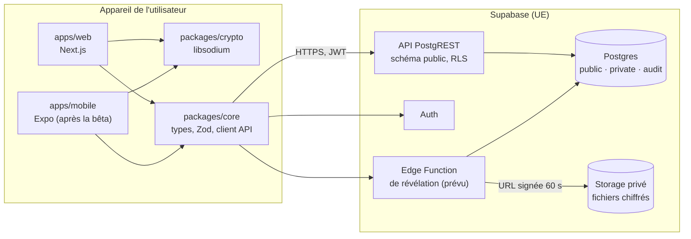
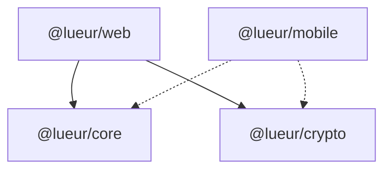

# Architecture de Lueur

Vue d'ensemble technique du projet. Le « pourquoi » des choix structurants est dans les
[ADR](docs/adr/README.md) ; le modèle de données dans [DATA_MODEL.md](docs/DATA_MODEL.md) ; la
sécurité dans [SECURITY.md](SECURITY.md).

> État : **étape 1** (fondations). Les sections marquées « prévu » décrivent la cible des
> [spécifications](docs/SPECS.md) et seront complétées au fil des étapes.

## Vue d'ensemble

Le serveur ne reçoit que des données chiffrées sur l'appareil ; il connaît les dates et qui envoie
à qui, jamais le contenu (règle 1 du CLAUDE.md).

## Organisation du dépôt

| Dossier           | Rôle                                                                    |
| ----------------- | ----------------------------------------------------------------------- |
| `apps/web`        | Site web responsive (Next.js, App Router), CSP stricte à nonce          |
| `apps/mobile`     | Application Expo, squelette développé après la bêta                     |
| `packages/crypto` | **Toute** la cryptographie (libsodium) ; interdite ailleurs par le lint |
| `packages/core`   | Types du domaine, schémas Zod, erreurs métier, client API               |
| `supabase/`       | Configuration locale, migrations, retours arrière, tests pgTAP          |
| `docs/`           | Spécifications, modèle de données, ADR, documents légaux                |
| `.github/`        | CI, analyses de sécurité, Dependabot                                    |
| `.claude/`        | Sous-agents, hooks et permissions de Claude Code                        |

Paquets prévus par les specs : `packages/design-tokens`, `packages/ui-web`, `packages/ui-native`.

### Dépendances entre paquets

Les paquets partagés sont consommés directement en TypeScript (sans étape de build) et ne
dépendent d'aucune API propre à une plateforme.

## Couches

Chaque fonctionnalité suit quatre couches (CLAUDE.md, « Style de code ») :

| Couche         | Contenu                                           | Dépend de              |
| -------------- | ------------------------------------------------- | ---------------------- |
| Domaine        | Règles métier pures, types, erreurs métier typées | Rien d'externe         |
| Application    | Cas d'usage (envoyer une photo, ouvrir une case…) | Domaine                |
| Infrastructure | Supabase, stockage, push, cryptographie           | Domaine, bibliothèques |
| Interface      | Pages Next.js, écrans Expo, composants            | Application            |

Le domaine et l'application vivent dans `packages/` pour être partagés par le web et le mobile.

## Base de données

- Schémas `public` (exposé, sous RLS), `private` (fonctions internes), `audit` (journal).
- Aucun droit par défaut ; `GRANT` explicites et RLS sur chaque table.
- Clés primaires UUID v7, dates `timestamptz` sauf `reveal_local`.
- L'accès à un item passe uniquement par `can_access_item` (prévu, étape 5).
- Garde-fous automatiques et retours arrière vérifiés : voir [DATA_MODEL.md](docs/DATA_MODEL.md).

## Flux principaux (prévus)

**Envoi d'une photo** (étape 5) : suppression des EXIF et redimensionnement sur l'appareil →
clé aléatoire → chiffrement XChaCha20-Poly1305 → clé enveloppée pour chaque destinataire et pour
l'expéditeur → signature Ed25519 → fichier chiffré dans le Storage
(`{calendar_id}/{item_id}.bin`), clés enveloppées en base.

**Révélation** (étape 6) : le client appelle l'Edge Function → authentification, destinataire,
`now()` du serveur dans le fuseau effectif du destinataire ≥ `reveal_local`, via
`can_access_item` → URL signée de 60 s → téléchargement → vérification de la signature →
déchiffrement sur l'appareil.

## Environnements et hébergement

| Environnement | Base et services                    | Site web                       |
| ------------- | ----------------------------------- | ------------------------------ |
| Local         | Supabase local (Docker), `pnpm dev` | `next dev` (port 3000)         |
| Bêta          | Supabase Cloud, région UE           | Scaleway Serverless Containers |
| Après la bêta | Supabase auto-hébergé sur Scaleway  | Scaleway Serverless Containers |

Aucune fonctionnalité propre au cloud Supabase ; infrastructure décrite en Terraform (prévu).

## Qualité et CI

| Workflow       | Contrôles                                                                                                   |
| -------------- | ----------------------------------------------------------------------------------------------------------- |
| `ci.yml`       | Format, lint, typecheck, tests unitaires, `pnpm audit`, e2e Playwright, base (lint, pgTAP, retours arrière) |
| `security.yml` | gitleaks, Semgrep, actionlint, zizmor, revue des dépendances                                                |
| `codeql.yml`   | CodeQL `security-extended` (TypeScript et workflows)                                                        |

En local, les hooks Claude Code formatent, lintent et typent chaque fichier modifié et lancent les
tests concernés avant la fin d'une tâche ([.claude/README.md](.claude/README.md)).
